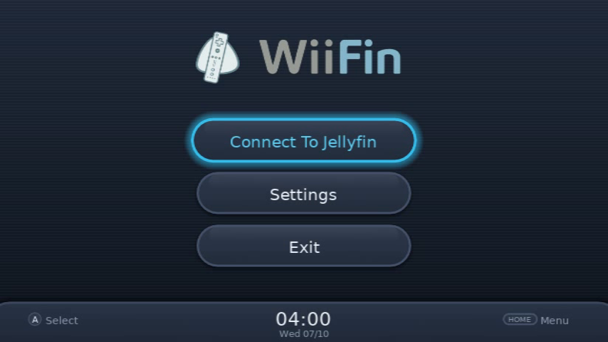
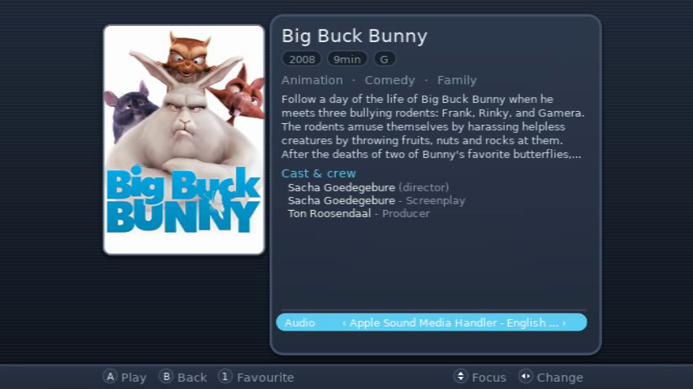
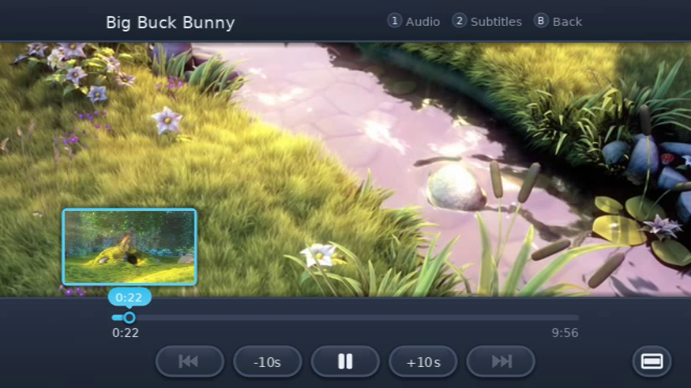
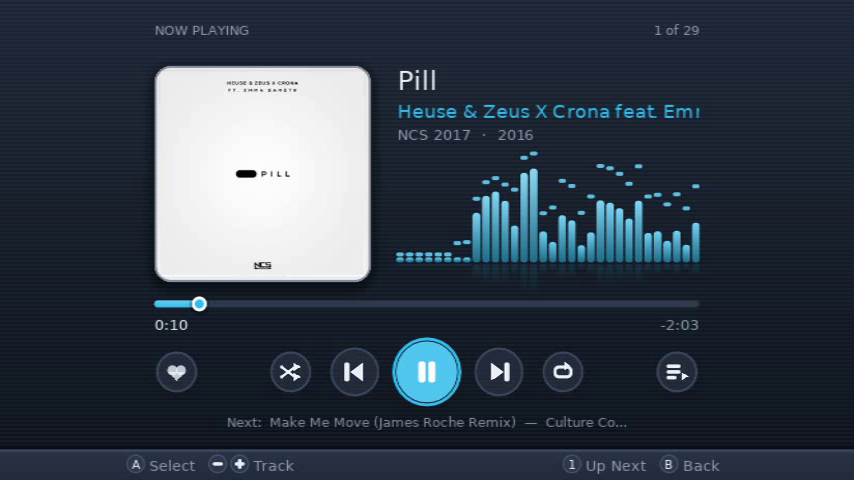

   
  <em>Client Jellyfin per Nintendo Wii</em>

  
  &nbsp;
  
  &nbsp;
  
  &nbsp;
  
  &nbsp;
  

---

<strong>WiiFin</strong> è un client homebrew sperimentale per <a href="https://jellyfin.org">Jellyfin</a>, pensato apposta per Nintendo Wii. 
Sfoglia e riproduce i tuoi film, serie e musica direttamente sulla console. È scritto in C++ con <a href="https://github.com/GRRLIB/GRRLIB">GRRLIB</a> e <a href="https://github.com/extremscorner/mplayer-ce">MPlayer CE</a>.

<table align="center">
  <tr>
    <td></td>
    <td></td>
  </tr>
  <tr>
    <td></td>
    <td></td>
  </tr>
</table>

<em>Big Buck Bunny</em> © Blender Foundation, <a href="https://peach.blender.org">peach.blender.org</a> (CC BY 3.0) · <em>Pill</em> di Heuse & Zeus X Crona feat. Emma Sameth, <a href="https://ncs.io">NCS</a>

---

## 📦 Installazione

Scarica i file dall'[ultima release](https://github.com/fabienmillet/WiiFin/releases):

- **Homebrew Channel**: estrai `WiiFin-hbc.zip` nella radice della tua scheda SD
- **Canale del menu Wii**: installa `WiiFin.wad` con un gestore di WAD (Wii e vWii); per cinese o coreano, copia anche `apps/WiiFin/fonts/` dallo zip sulla scheda SD
- **Dolphin**: apri `WiiFin.dol`

Poi accedi al tuo server Jellyfin con nome utente e password, oppure con Quick Connect.

## ✨ Punti di forza

- **Film, serie e musica** dal tuo Jellyfin: riproduzione diretta di ciò che la Wii decodifica, il server converte il resto
- Una schermata iniziale a **righe** o a **griglia**, schede, ordinamento e filtri, ricerca, A-Z
- Un **lettore** con le miniature del server, scene e capitoli, salta intro / titoli di coda, episodio successivo, tracce audio e sottotitoli, riprendi da dove avevi lasciato
- **Musica**: una schermata In riproduzione con visualizzatori e testi sincronizzati; continua mentre sfogli
- **Foto** con presentazione, e playlist di video
- **Profili**: più account e server, un codice se vuoi, ognuno con il suo tema
- **Controllo remoto** dalla dashboard e dalle app di Jellyfin: Riproduci su… Nintendo Wii
- Le **dieci lingue della Wii**; Wiimote, Controller Classico, controller GameCube o Wii U GamePad, senza barra sensore

Tutto ciò che fa, i controlli, le impostazioni e i suoni personalizzati: la **[guida utente](../docs/USER_GUIDE.md)** (in inglese).

## ⚠️ Stato del progetto

> 🚧 **Sperimentale**: funzionante, ma ancora in pieno sviluppo. Su una console vera possono esserci imperfezioni.

- Riproduzione diretta solo per i video SD (vedi [DIRECT_PLAY.md](../DIRECT_PLAY.md)); audio stereo
- I sottotitoli a immagine (PGS, VobSub) li imprime il server nel video
- Altro nelle [limitazioni note](../docs/USER_GUIDE.md#%EF%B8%8F-known-limitations)

## 🤝 Contribuire

Pull request, segnalazioni di bug e idee sono benvenute:

* 📘 Le [linee guida per contribuire](../CONTRIBUTING.md), e come [compilare WiiFin](../docs/BUILDING.md)
* 🌍 [Tradurre](../lang/README.md) WiiFin nella tua lingua
* 🐛 Una [segnalazione di bug](../.github/ISSUE_TEMPLATE/bug_report.yml) (con `apps/WiiFin/wiifin.log` dalla scheda SD) o una 💡 [richiesta di funzionalità](../.github/ISSUE_TEMPLATE/feature_request.yml)

## 📜 Licenza

Questo progetto è distribuito con licenza **GPLv3**.
Vedi il file [LICENSE](../LICENSE) per i dettagli.
